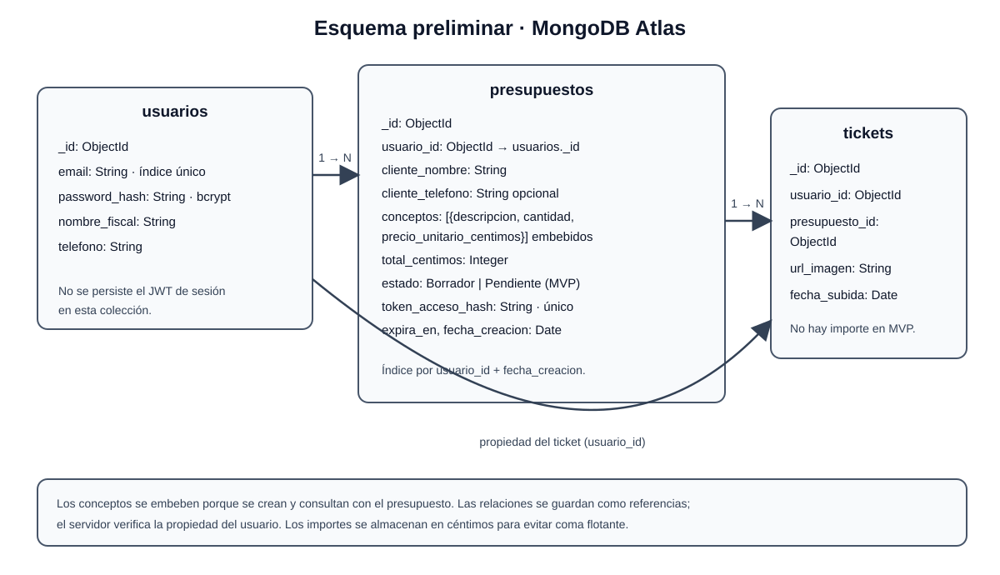
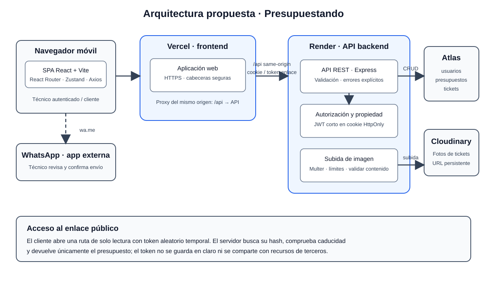

# Propuesta de proyecto: Presupuestando

## Introducción

**Presupuestando** es una aplicación web *mobile-first* para profesionales autónomos de oficios que trabajan fuera de una oficina. La hipótesis que el equipo quiere validar es que crear y compartir un presupuesto desde el lugar de trabajo, y archivar allí mismo la fotografía de un ticket, resulta hoy innecesariamente lento o difícil para algunos de estos profesionales. La hipótesis todavía no está validada con entrevistas ni datos de usuarios; por ello, este documento no presenta como hechos la frecuencia del problema, pérdidas económicas o insatisfacción con las herramientas existentes.

El MVP permite que un técnico se registre e inicie sesión, cree un presupuesto, genere un enlace temporal de solo lectura y prepare el mensaje para compartirlo por WhatsApp. También permite fotografiar un ticket y asociarlo al presupuesto propio. El cliente puede consultar el presupuesto sin registrarse, pero no aceptarlo ni rechazarlo en esta primera versión. La solución propuesta emplea MongoDB, Express, React y Node.js, con Vercel y Render para el despliegue educativo y Cloudinary para almacenar imágenes, siempre dentro de los límites y condiciones de los planes vigentes.

El equipo está formado por cuatro integrantes con responsabilidades de frontend, backend, datos y pruebas/despliegue. Antes de afirmar que el producto resuelve una necesidad real, el equipo realizará entrevistas y pruebas de usabilidad, y documentará el método, los resultados anonimizados y las limitaciones de la muestra.

## 1. Detección del problema

### 1.1 Ideas consideradas

| Idea | Problema y usuarios | Decisión |
|---|---|---|
| Aprender y recordar técnicas de BJJ | Practicantes principiantes o con experiencia que necesitan repasar técnicas. | No seleccionada; se consideró que el equipo no había acotado un caso de uso diferenciador ni un público inicial suficientemente concreto. |
| Gestionar plazos y requisitos de becas y ayudas | Estudiantes y solicitantes que buscan requisitos y fechas. | No seleccionada; mantener información fiable y actualizada exigiría una fuente y un proceso editorial que el equipo no definió para el MVP. |
| Presupuestos y archivo de tickets para autónomos de oficios | Profesionales en movilidad que preparan presupuestos y registran gastos durante visitas. | Seleccionada para investigar y construir un MVP MERN acotado. La diferenciación y la necesidad siguen pendientes de validación primaria. |
| Recordatorios de medicación para personas mayores | Personas mayores y familiares o cuidadores que necesitan recordar o confirmar tomas. | No seleccionada; accesibilidad, notificaciones fiables y el contexto sensible de salud ampliarían el alcance y las responsabilidades del MVP. |

### 1.2 Problema e investigación pendiente

El problema investigable es si los profesionales de oficios retrasan presupuestos o tienen dificultades para archivar tickets debido a que trabajan fuera de una oficina y las herramientas o procesos que usan no se ajustan a esa situación. Frecuencia e impacto están **pendientes de medir**; no se dispone de entrevistas, encuesta ni datos que permitan cuantificar cuántos usuarios lo experimentan.

El equipo entrevistará al menos a cinco autónomos de distintos oficios. Se les pedirá que describan un caso reciente, sus herramientas y pasos, el tiempo invertido, cualquier retraso y cómo guardaron los justificantes. Las preguntas serán neutrales; se recogerán respuestas anonimizadas, fecha y perfil general, y se registrarán tanto los patrones como los casos que contradigan la hipótesis. Se evitará recopilar nombres, datos fiscales, datos de clientes o imágenes de documentos. Los resultados se incorporarán a [01-problema.md](propuesta/01-problema.md) antes de la entrega final. La muestra será exploratoria y no representativa.

### 1.3 Usuarios hipotéticos

Las personas descritas son arquetipos de diseño, no participantes entrevistados ni perfiles cuya representatividad se haya demostrado.

**Paco, 52 años, electricista autónomo (arquetipo hipotético)**

- **Contexto:** atiende trabajos en domicilios y se desplaza entre clientes y proveedores; su familiaridad con herramientas de gestión móvil debe validarse.
- **Necesidades:** preparar un presupuesto claro durante o después de la visita y guardar un justificante asociado al trabajo.
- **Frustraciones por validar:** volver a introducir datos al final de la jornada, teclear en el móvil durante el trabajo y recordar dónde guardó un ticket.
- **Objetivos:** compartir la propuesta desde el lugar del trabajo y localizar después el gasto relacionado.
- **Casos de uso:** iniciar sesión, crear el presupuesto, generar un enlace temporal de consulta, preparar su envío por WhatsApp y asociar una foto de ticket.

**Elena, 41 años, clienta particular (arquetipo hipotético)**

- **Contexto:** recibe de un profesional una propuesta para un trabajo en su domicilio y la consulta desde su teléfono.
- **Necesidades:** ver el desglose y el total del presupuesto.
- **Frustraciones por validar:** buscar la información entre mensajes o tener que instalar una aplicación o crear una cuenta.
- **Objetivos:** consultar y conservar la información mediante un enlace sencillo.
- **Caso de uso MVP:** abrir el enlace temporal y consultar el presupuesto sin registrarse. Aceptar o rechazar no está incluido.

### 1.4 Alternativas y propuesta de valor

| Alternativa | Fortalezas documentadas | Limitaciones conocidas / no verificadas | Oportunidad que se investigará |
|---|---|---|---|
| Holded | Su página anuncia presupuestos, facturas, contactos y funciones financieras. App Store mostraba 4,5/5 sobre 551 valoraciones el 25/10/2026. | La amplitud no prueba complejidad ni mala adaptación móvil. Algunas reseñas individuales refieren incidencias de documentos y cámara; son autoseleccionadas. | Probar el flujo móvil y preguntar si el público necesita una herramienta más acotada. |
| FacturaDirecta | Su web anuncia facturación, presupuestos y gastos, con límites publicados para el plan gratuito. | Esos límites no permiten inferir facilidad de uso ni pasos de trabajo; no se ha probado el producto. | Comparar el mismo escenario móvil y registrar pasos, tiempos y bloqueos observados. |
| FactuPro | Su guía comercial anuncia facturación por WhatsApp y registro de gastos con fotos de tickets. | Sus afirmaciones de rapidez y automatización son del proveedor, no una evaluación independiente. | Comparar el alcance: el MVP no incluye facturas fiscales ni OCR; comprobar si asociar ticket y presupuesto aporta algo distintivo. |
| SinTrámite | Su guía comercial describe captura y organización móvil de tickets con filtros y exportación. | La fuente no aporta metodología independiente para sus estimaciones económicas. | Validar si asociar el ticket al trabajo es útil frente a un archivo de gastos independiente. |
| Libreta y WhatsApp | Alternativa manual planteada por el equipo, potencialmente flexible y familiar. | Su uso real y sus problemas no se han confirmado mediante entrevistas. | Preguntar qué usan las personas y cómo recuperan presupuestos y justificantes. |

Las características de Holded y FacturaDirecta se basan en [sus páginas de planes](https://www.holded.com/es/precios) y [FacturaDirecta](https://www.facturadirecta.com/pequenos-negocios/precios/); las de FactuPro y SinTrámite en [sus guías comerciales](https://factupro.es/blog/facturar-por-whatsapp) y [de organización de tickets](https://sintramite.es/organizar-tickets-autonomos). La ficha de [Holded en App Store](https://apps.apple.com/es/app/holded-facturaci%C3%B3n-y-mucho-m%C3%A1s/id1369704574?see-all=reviews) mostraba la valoración y las reseñas descritas arriba. Consultas realizadas el 25 de octubre de 2026. La tabla distingue material comercial y reseñas de evidencia primaria; el protocolo de entrevistas y las instrucciones para una prueba comparativa están en [01-problema.md](propuesta/01-problema.md).

**Propuesta de valor hipotética:** «Para profesionales de oficios que preparan presupuestos y guardan gastos durante su jornada, Presupuestando ofrece un recorrido web móvil para consultar un presupuesto mediante un enlace temporal de solo lectura y asociar la fotografía de un ticket al trabajo, sin que el cliente necesite una cuenta». No se afirma que sea la única solución que usa WhatsApp o captura tickets; la diferenciación propuesta debe compararse y validarse con usuarios.

## 2. Viabilidad técnica

### 2.1 Requisitos funcionales y priorización MoSCoW

**Must (7 de 14, exactamente el 50 % permitido)**

1. Registrar una cuenta de técnico.
2. Iniciar sesión como técnico desde un navegador móvil.
3. Crear y guardar un presupuesto con los datos mínimos del cliente y una o más líneas de concepto.
4. Generar un enlace temporal de solo lectura para consultar el presupuesto sin cuenta.
5. Preparar un mensaje de WhatsApp con el enlace; el técnico confirma personalmente el envío.
6. Capturar o seleccionar y subir una fotografía de un ticket.
7. Asociar el ticket a un presupuesto propio.

**Should**

8. Permitir aceptar o rechazar el presupuesto desde el enlace público.
9. Consultar el histórico de presupuestos y su estado.
10. Consultar el total mensual de gastos archivados.

**Could**

11. Calcular el beneficio neto de un trabajo con los importes de sus tickets.
12. Descargar en PDF un presupuesto aceptado.

**Won’t en esta iteración**

13. Integrar cuentas bancarias para conciliación de pagos.
14. Gestionar inventario o existencias de materiales.

### 2.2 MVP y recorrido mínimo

El cliente consulta el presupuesto como parte del requisito RF-04: generar un enlace que no permita ver el presupuesto no satisface el MVP. El enlace solo muestra el contenido y caduca; no permite cambiar su estado. El recorrido mínimo es: el técnico registra una cuenta si todavía no tiene una, inicia sesión, introduce conceptos e importes, guarda el presupuesto, obtiene un enlace temporal, lo comparte mediante WhatsApp y registra una fotografía de un ticket asociada al trabajo.

### 2.3 Stack, arquitectura y datos

- **Frontend:** React con Vite; React Router para `/login`, `/panel`, `/nuevo-presupuesto` y `/p/:token`; Zustand para estado de interfaz no sensible; Axios para la API; React Hook Form para validación de formularios; CSS nativo y `lucide-react`.
- **Backend:** Node.js y Express, API REST, JWT de corta duración y bcrypt para hash de contraseña; Multer con límites estrictos y validación del contenido de las imágenes.
- **Datos y archivos:** MongoDB Atlas para usuarios, presupuestos y tickets; Cloudinary para almacenamiento y entrega de fotografías.
- **Despliegue previsto:** Vercel para la aplicación web y Render para la API. La demo es educativa, no de producción ni de cumplimiento fiscal.

MongoDB es una opción a validar: los conceptos pueden almacenarse embebidos porque se crean y consultan junto al presupuesto; las relaciones de propietario y ticket se representan mediante referencias.

| Colección | Campos principales y relaciones |
|---|---|
| `usuarios` | `_id`, `email` (único), `password_hash`, `nombre_fiscal`, `telefono`. |
| `presupuestos` | `_id`, `usuario_id`, `cliente_nombre`, `cliente_telefono`, `conceptos` embebidos (`descripcion`, `cantidad`, `precio_unitario_centimos`), `total_centimos`, `estado`, `token_acceso_hash`, `expira_en`, `fecha_creacion`. |
| `tickets` | `_id`, `usuario_id`, `presupuesto_id`, `url_imagen`, `fecha_subida`. El importe del ticket queda fuera del MVP y se necesitará para calcular márgenes en RF-11. |

Se crearán índices únicos para el correo y el hash del token, y consultas indexadas por propietario, presupuesto y fecha. Los importes se almacenarán como enteros en céntimos. El token del enlace será aleatorio y de alta entropía; se guardará su hash y fecha de caducidad. Los presupuestos no se eliminarán automáticamente al caducar el enlace.

### 2.4 Arquitectura propuesta

La SPA se sirve desde Vercel y usará una ruta proxy `/api` del mismo origen hacia Express en Render para reducir la dependencia de cookies entre sitios. La sesión del técnico viajará en una cookie `HttpOnly`, `Secure` y `SameSite=Lax`; las mutaciones protegidas tendrán defensa CSRF. El cliente consulta un presupuesto mediante un enlace aleatorio temporal: el servidor compara el hash del token, comprueba su caducidad y devuelve solo lectura. El técnico debe confirmar el mensaje de WhatsApp. Express valida cargas antes de enviarlas a Cloudinary y comprueba la propiedad del presupuesto antes de registrar el ticket.

### 2.5 Seguridad, privacidad y restricciones de servicios

- El servidor validará la sesión y comprobará que el técnico solo accede a sus propios presupuestos y tickets. Las contraseñas nunca se guardarán en texto claro.
- El JWT no se almacenará en `localStorage` ni en Zustand. La solución prevista usa una cookie `HttpOnly`, `Secure` y `SameSite=Lax`, controles CSRF para las mutaciones y restricciones CORS. Se evaluará exponer la API con un proxy `/api` bajo el mismo origen del frontend o usar dominios propios del mismo sitio; la configuración deberá probarse en Safari y Chrome.
- Se limitará el tamaño de las cargas de imagen y se validará el contenido, no solo la extensión o el MIME anunciado por el navegador.
- Para pruebas se usarán datos sintéticos. Una foto real solo se empleará con autorización explícita y ocultando datos fiscales o personales; se eliminarán las pruebas al terminar la evaluación.
- Los límites y precios de los planes cambian. A fecha de consulta, Atlas Free publica 512 MB y limitaciones de regiones/configuración; Cloudinary Free publica 25 créditos mensuales cuyo consumo depende de los recursos usados; Render Free proporciona 750 horas por *workspace*, suspende servicios sin tráfico durante 15 minutos y advierte que sus instancias gratuitas no son para producción. Vercel Hobby tiene límites de uso y condiciones de elegibilidad que deben comprobarse para el uso previsto.
- Fuentes oficiales consultadas el 25 de octubre de 2026: [Atlas Free](https://www.mongodb.com/docs/atlas/reference/free-shared-limitations/), [Cloudinary](https://cloudinary.com/pricing), [Render](https://render.com/docs/free) y [Vercel](https://vercel.com/pricing). Estimación del prototipo: 0 USD en esos planes gratuitos, solo si el uso permanece dentro de sus límites y sus condiciones; revisar antes de desplegar.

### 2.6 Capacidades, lagunas y riesgos

El inventario inicial de habilidades y las lagunas identificadas se recogen en [02-viabilidad-tecnica.md](propuesta/02-viabilidad-tecnica.md). Es una autoevaluación; se revisará durante las pruebas de concepto. El alcance de siete requisitos Must parece abordable, pero la duración exacta debe contrastarse con las semanas disponibles y con las pruebas de autenticación, enlace temporal, carga de imagen y despliegue.

| Riesgo | Mitigación |
|---|---|
| Fallo o exceso de tiempo en la subida a Cloudinary | Probar desde la primera semana el recorrido cámara → API → almacenamiento con límite de tamaño y errores visibles. |
| Conflictos o pérdida de cambios al integrar | Ramas por issue, PR revisados por otra persona y protección técnica de las ramas. |
| Errores de CORS, cookies o configuración en producción | Desplegar un flujo mínimo de extremo a extremo pronto y probar navegadores móviles y dominios reales. |
| Arranque lento de Render tras inactividad | Mostrar progreso, permitir reintento y comunicar el fallo; no depender de pings para eludir la suspensión. |
| Falta de tiempo para terminar el MVP | Congelar Should y Could hasta completar los siete Must y probar el recorrido integral. |

## 3. Objetivos, alcance y evaluación

### 3.1 Objetivo general

Facilitar que profesionales autónomos de oficios creen y consulten presupuestos y archiven tickets desde el móvil durante su jornada.

### 3.2 Objetivos específicos SMART

| ID | Indicador de éxito | Comprobación antes de la defensa final |
|---|---|---|
| OBJ-01: reducir el esfuerzo de preparar y compartir un presupuesto desde el lugar de trabajo | Al menos 4 de 5 participantes completan la tarea en menos de 3 minutos. | Cronometrar una tarea con cada uno de cinco autónomos de distintos oficios; anotar errores y abandonos. |
| OBJ-02: facilitar el archivo inmediato de un ticket de gasto asociado al trabajo | Al menos 4 de 5 participantes completan la tarea en menos de 30 segundos con 4G o equivalente. | Cronometrar una tarea con cada uno de los mismos cinco autónomos y separar captura, carga y asociación. |
| OBJ-03: facilitar al cliente la consulta del presupuesto recibido sin crear una cuenta | Al menos 4 de 5 participantes encuentran conceptos y total en menos de 1 minuto. | Prueba con al menos cinco personas que representen clientes, en sus teléfonos. No incluye aprobación. |
| OBJ-04: reducir el peso de fotografías sin perder legibilidad | Al menos 9 de 10 imágenes inferiores a 500 KB y con texto principal legible. | Medir peso y revisar legibilidad en diez fotos tomadas con al menos tres móviles distintos. |

La muestra es pequeña y exploratoria; los resultados no se generalizarán estadísticamente. El protocolo y las limitaciones se documentarán junto a los resultados.

### 3.3 Límites

Incluye una web adaptable a móvil, un rol autenticado (técnico), acceso público de solo lectura mediante enlace temporal y datos sintéticos para la demo. No incluye aplicaciones nativas, aceptación/rechazo, gestión de inventario, pagos, conciliación bancaria, facturación fiscal oficial, integraciones de gestoría ni uso de datos reales de clientes.

Ampliaciones priorizadas: aceptación/rechazo; historial y gastos mensuales; cálculo de beneficio y PDF; evaluación futura de integraciones fiscales conforme a necesidades y requisitos legales.

## 4. Recursos y organización

### 4.1 Equipo y responsabilidades

| Persona | Usuario GitHub | Rol |
|---|---|---|
| Dylan Bauti Huelva | [@dbauhue1708](https://github.com/dbauhue1708) | Frontend Lead & UX; React, navegación y accesibilidad móvil. |
| Rocío Luque Montes | [@lmrocio](https://github.com/lmrocio) | Frontend y usabilidad; vistas, formularios, cámara y pruebas con usuarios. |
| Manuel Amado Rodríguez | [@mamarod428](https://github.com/mamarod428) | Backend Lead & Auth; API, autenticación y carga de archivos. |
| José Luis Yuani Barea | [@jyuanib](https://github.com/jyuanib) | Database Manager & QA/DevOps; MongoDB, almacenamiento, pruebas y despliegue. |

Los módulos asignan dueño y apoyo: autenticación (Manuel/Dylan), presupuestos y enlace (Dylan/Rocío), tickets (José Luis/Manuel). Los leads revisan cambios de su capa, pero ninguna persona aprueba su propio PR.

### 4.2 Versiones y herramientas

Referencias de versiones consultadas el 25 de octubre de 2026; se comprobará compatibilidad y se fijarán dependencias exactas en los archivos de bloqueo al crear la aplicación. No están instaladas todavía.

| Herramienta | Versión de referencia | Uso |
|---|---:|---|
| Node.js | 24.22.1 LTS | Runtime compartido. |
| React / React DOM | 19.3.1 | Interfaz. |
| Vite | 8.3.5 | Desarrollo y compilación. |
| React Router DOM | 7.18.4 | Rutas. |
| Zustand | 5.0.16 | Estado de interfaz. |
| Axios | 1.20.0 | Peticiones HTTP. |
| React Hook Form | 7.91.0 | Formularios. |
| lucide-react | 1.61.0 | Iconos. |
| Express | 5.3.0 | API. |
| Mongoose | 9.11.4 | Modelos MongoDB. |
| Multer | 2.5.0 | Carga multipart. |
| bcrypt | 6.0.0 | Hash de contraseña. |
| jsonwebtoken | 9.0.3 | Sesión firmada. |
| Vitest | 5.0.5 | Pruebas frontend. |
| Jest / Supertest | 30.5.2 / 7.3.1 | Pruebas de integración backend. |

Herramientas de trabajo: VS Code, ESLint y Prettier con configuración compartida; Bruno o Postman para pruebas manuales de la API; Git y GitHub para versiones y revisión; GitHub Projects para tareas; comunicación y normas de bloqueo conforme a [CONTRATO.md](CONTRATO.md). Se recomienda ejecutar pruebas y comprobaciones de formato antes de aceptar cada PR.

### 4.3 Repositorio y flujo de trabajo

Estructura prevista: `client/` para React, `server/` para Node y Express, `docs/` para contrato y propuesta. El `.gitignore` excluye `node_modules/`, `.env`, `dist/` y `build/`; no se subirán credenciales.

Ramas previstas: `main` para la versión estable, `develop` para integración y ramas `feature/<número-issue>-<tarea>` o `fix/<número-issue>-<tarea>` creadas desde `develop`. El trabajo entra por PR con issue vinculado, review aprobada de otra persona y sin merge por el autor. Al cerrar un sprint, se propone `develop` a `main`. La existencia de protección de ramas y de un tablero activo se debe comprobar en GitHub; este documento no afirma que esa configuración esté verificada.

## Documentos de apoyo

- [README del proyecto](../README.md)
- [Brainstorming](propuesta/00-brainstorming.md)
- [Problema y usuarios](propuesta/01-problema.md)
- [Viabilidad técnica](propuesta/02-viabilidad-tecnica.md)
- [Objetivos y alcance](propuesta/03-objetivos-y-alcance.md)
- [Recursos](propuesta/04-recursos.md)
